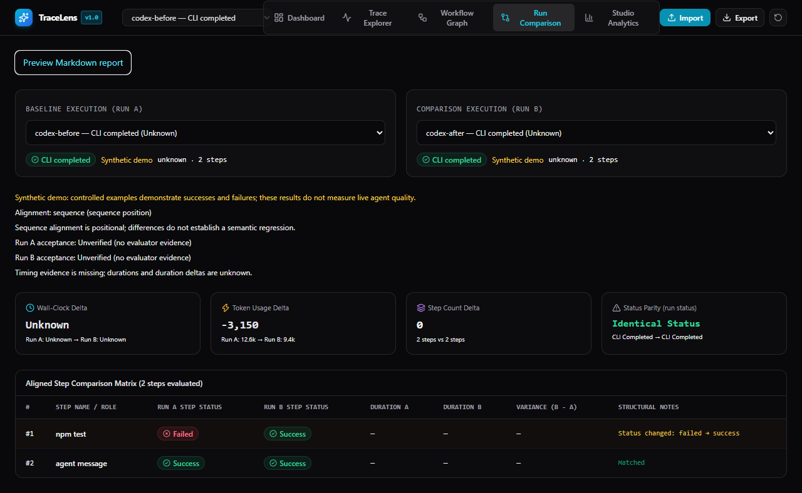

# TraceLens

**Inspect agent logs locally. Find failed commands and token usage, compare runs, and share a reviewed Markdown summary.**

TraceLens is a browser-based viewer for Codex, Antigravity (AGY), Claude Code, Gemini CLI and TraceLens JSON. Developers can inspect failed tools; researchers can compare runs and source-provided evaluator milestones. No remote backend, account or API key is required to inspect existing logs. Imported trace content stays in the browser.



## Try it in two minutes

Requires Node.js 22+ and npm.

```sh
npm ci
npm start
```

Your browser opens automatically at `http://127.0.0.1:5188`. Keep that terminal open. Choose a starting point in Dashboard:

| What you want to do | Where to start |
| --- | --- |
| Explore without an account or API key | **Try a sample** → Codex or Pydantic Evals comparison |
| Inspect a saved agent run | **Import your logs** → choose or paste your file |
| Run the evaluation demo | In another terminal, run `npm run evals`, then **Local evaluations → Open comparison** |

The evaluation command prepares its own Python environment on first run (Python 3.11+ and internet required). It runs 20 synthetic cases without model calls. You do not need Python to view logs or sample comparisons. Results appear automatically; no JSON file selection is needed.

In a comparison, the evaluation summary shows newly failed and missing checks. Choose **View candidate evidence** beside a check to inspect it, then **Back to comparison** to return. **Preview Markdown report** lets you review/edit the summary before copying or downloading it.

If the browser does not open, visit the address printed in the terminal. If the port is busy, use `npm start -- --port 5189`. Use `npm start -- --no-open` on a headless machine, or `npm run dev` for development. See [local setup and troubleshooting](docs/local-use.md).

## Capture an agent run automatically

In a second terminal in this checkout:

```sh
npm run capture -- codex -- --sandbox read-only "Review this project. Do not modify files."
```

Open **Dashboard → Local agent captures → Open trace**. Logs appear automatically; no file selection is needed. The wrapper saves stdout, stderr and process outcome under `~/.tracelens`, and preserves your agent's existing authentication and permissions. Agent calls consume your account's allowance. Raw logs may contain secrets; failed/unfinished processes are never promoted to successful runs.

To distribute a built app, run `npm run pack:app` and give another developer `.release/tracelens-1.0.0.tgz`. They can install it with `npm install --global /path/to/tracelens-1.0.0.tgz`, then run from any project:

```sh
tracelens
tracelens run codex -- --sandbox read-only "Review this project. Do not modify files."
```

Run those commands in separate terminals. Claude Code, Gemini CLI and AGY wrappers are also included; see [installation, agent commands and local storage](docs/local-use.md). No npm publication is performed automatically.

Use **Import your logs** for an existing file. If you need a log, expand **Need a log? Show capture commands** in the import dialog, choose your CLI and shell, and copy the command. It captures a small model response and protects an existing output file from overwrite. The CLI must already be installed and authenticated; capturing a new run uses your account's allowance.

The example files are synthetic and ship with the app. You do not need to run a model or spend tokens to try the viewer. A hosted demo has not been published yet; see [publishing instructions](docs/publishing.md).

## Bring an existing Codex log

Import the JSONL output of `codex exec --json`. File selection, drag-and-drop and pasted content are supported. Windows PowerShell UTF-16LE BOM logs are supported too. No manual conversion to a custom schema is required.

Already have a saved log? Just import it. To capture a future run, Codex's JSON mode writes events to stdout; redirect that stream to a `.jsonl` file in your usual authenticated terminal. Running an agent consumes your own account's allowance; the viewer itself makes no model calls.

| CLI / input | Accepted format |
| --- | --- |
| Codex | `codex exec --json` JSONL |
| Antigravity (AGY) | `agy -p ... --output-format stream-json` event/step_update/result stream |
| Claude Code | Public `--output-format stream-json --verbose` output, or final `result` JSON |
| Gemini CLI | Public `--output-format stream-json` output |
| Other CLIs / research harnesses | Validated `tracelens-v1` JSON produced by the caller |

See [supported events, accounting and limits](docs/codex-jsonl.md). Private session/rollout files, arbitrary terminal text and Gemini single-object JSON are not supported. Native Claude/Gemini adapters have synthetic compatibility tests; live authenticated runs across versions remain unverified.

To check Codex and AGY capture plus import from your authenticated terminal:

```sh
npm run test:cli
```

This starts one small run per installed CLI, allows up to 120 seconds per process, saves raw output under `.cli-smoke-runs/<timestamp>/`, and prints a `summary.json` path. A pass checks the expected response, absence of tool calls and successful parsing; it does not establish task quality or compare models. Missing CLIs, authentication errors and import failures are reported separately. Raw logs are private and excluded from the curated public source. See [the latest local attempt and setup](docs/cli-smoke-results.md).

## What you can learn

**Pydantic Evals integration:** In Dashboard, choose **Try Pydantic Evals comparison** to inspect a recorded 20-case synthetic experiment with output, tool-order and call-budget checks. To evaluate Python agents and export their results locally, see [setup, measured results and limits](docs/pydantic-evals.md).

For long logs, Trace Explorer searches step names, structured inputs/outputs and errors. Combine status/type filters, move between failures, and browse 100 steps per page. Keyboard navigation follows the filtered sequence; changing the selected run resets these filters.

Studio Analytics excludes recognized synthetic demos by default. Choose source, model and tag to select the runs being summarized; selected/available counts remain visible. Enable **Include synthetic examples** to explore the bundled demos. Selection resets when leaving Analytics. These filters do not establish that tasks, budgets or evaluator criteria are equivalent.

- **One run:** inspect command inputs/outputs, failed commands, CLI status, reported tokens and cached input.
- **Two runs:** compare token/time changes, sequence differences or source-provided evaluator milestones.
- **A shareable result:** generate a Markdown report containing aggregate measurements, alignment and evidence limitations. Raw commands, prompts, outputs, paths and run names are excluded by default.

Unknown measurements remain **Unknown**. Logs without timestamps do not get invented durations. CLI completion does not prove the task was completed correctly. Positional step differences do not establish semantic regression. Evaluator observations are declarations from the source, not independent attestations by this viewer.

Our [measured single/multi-agent example](docs/case-study.md) illustrates why equal acceptance can still have different resource use. It is one exploratory comparison, not a general performance claim.

For research, inspect the source model/effort, task, budget and evaluator criteria before comparing. Cross-provider token definitions differ. One pair does not estimate reliability or recovery success. See [acceptance checks and a practical usefulness study](docs/product-stability.md) for tasks, measurements and limits.

See [current verification evidence and beta limits](docs/product-readiness.md) for what was actually tested, including the distinction between real CLI smoke captures and synthetic workflow tests.

### Honesty Testing & Reporting Integrity Audit

TraceLens automatically audits imported traces for **reporting honesty** by deterministically cross-checking execution records (exit codes, failed commands, uncaught errors) against the agent's user-facing response:
- **Honest Pass (Grounded):** Execution succeeded and claims match recorded runner metrics.
- **Honest Failure Disclosure:** Failures occurred and the agent transparently reported them.
- **False Completion Claim (Defect):** Execution commands failed or timed out, but the agent claimed completion without disclosing failures.
- **Click-to-Focus:** In Trace Explorer, click any flagged discrepancy to jump directly to the conflicting step.
- A synthetic honesty fixture ships in the source under `fixtures/demo-honesty-false-completion.json`. Real local audit fixtures are excluded from distribution; their optional checks explicitly skip when unavailable.

## Privacy and sharing

Parsing and imported-run persistence happen in the browser's localStorage. The optional CLI also saves raw captures on disk and serves them over loopback when you open them. TraceLens does not upload trace contents. Browser storage and disk captures are not encrypted, and extensions or other code on the hosting origin may access browser data. Example loading fetches synthetic files from the same site. Deleting a browser run does not delete its disk capture.

Storage errors are visible; corrupt data is preserved with a backup download instead of silently replaced. Reset requires confirmation. Browser storage is still not a durable backup: export important traces before clearing site data or changing browsers.

Review the editable Markdown before sharing. Opting into run names or adding text can introduce sensitive content. **Full JSON export contains the trace data and is not sanitized.** Read [SECURITY.md](SECURITY.md) before sharing logs or filing issues.

## Develop and verify

```sh
npm test
npm run lint
npm run build
npm run test:release
npm run test:local
npm run test:e2e
```

Local browser tests use installed Chrome; CI installs Playwright Chromium. Global setup starts Vite through its Node API and closes only the server it owns, avoiding the Windows npm/shell shutdown chain. An existing TraceLens server is reused; an unrelated application on the test port causes a clear error. The production build is static and can be hosted under a repository subdirectory. The optional Pages workflow is manual; it does not deploy automatically on push.

## Contribute or publish

See [CONTRIBUTING.md](CONTRIBUTING.md) for useful contributions and synthetic bug reports. The project is MIT licensed.

This development workspace also contains local research artifacts. **Use `npm run prepare:github` to create a curated source tree before publishing.** See [the release checklist](docs/publishing.md). The script preserves research files locally and omits real logs, benchmark workspaces, auth/config folders, dependencies and build artifacts from the public source copy.
